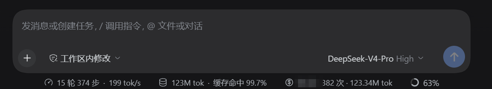
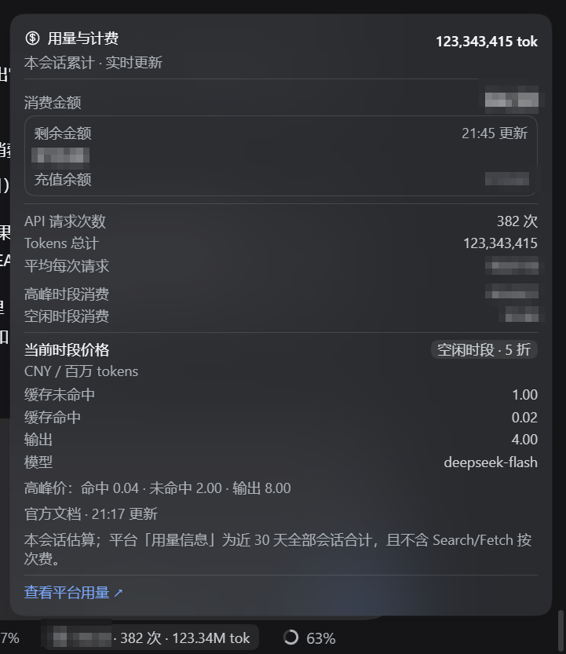

# 用量与计费（@vacum972/dsh-usage-billing）

[](https://dsh-plugin.org/plugins/vacum972/dsh-usage-billing)

DeepSeek Harness（DSH）Web 界面插件：在输入框（Composer）下方常驻一枚**实时用量胶囊**，点开查看本会话的
消费金额、剩余金额、API 请求次数、Tokens 与**当前时段官方价目**。

- **按官方峰谷价目逐次请求计价**：每次模型请求按它发生时刻的时段（高峰/空闲）计价，切换时段不重算历史；
- **价目自动校准**：Host 定期拉取 DeepSeek 官方价目文档，解析模型价格；失败时回退到上次成功价目并在弹窗提示，
  且每 2 分钟自动重试；
- **法定节假日日历**：自动获取中国法定节假日，高峰/空闲判断与官方规则一致（周末与节假日全天空闲）；
- **剩余金额**：读取当前登录账号的充值余额 + 赠送余额，打开弹窗即刷新、之后每 60 秒更新，可手动重试；
- **上下文不打扰**：胶囊与弹窗样式对齐宿主 composer 统计控件，紧凑布局，不会遮挡输入框。

## 界面预览

输入框下方的一枚实时胶囊（在宿主自带的轮次/上下文指标右侧）：



点开后的详情弹窗：消费金额、剩余金额、请求次数、Tokens 总计、平均成本、高峰/空闲时段消费拆分，
以及当前时段生效的官方价目：



> 截图为隐私脱敏示意：**金额与余额已打码（马赛克）**，请求次数、Tokens 与官方价目为真实数据。

## 时段与价目（确保准确）

按 [DeepSeek 官方价目页](https://api-docs.deepseek.com/zh-cn/quick_start/pricing) 的规则：

- 高峰时段：北京时间周一至周五（不含中国法定节假日）**09:00–12:00、14:00–18:00**；
- 其余时间（含周末、法定节假日全天）为空闲时段，**空闲价 = 高峰价的一半**；
- 出厂价目（2026-11-04 抓取，元 / 百万 tokens）：

| 模型 | 输入（缓存命中） | 输入（缓存未命中） | 输出 |
|---|---|---|---|
| deepseek-flash | 0.04 高峰 / 0.02 空闲 | 2 高峰 / 1 空闲 | 8 高峰 / 4 空闲 |
| deepseek-v4-pro | 0.30 高峰 / 0.15 空闲 | 9.0 高峰 / 4.5 空闲 | 27.0 高峰 / 13.5 空闲 |

自动刷新：正常情况下每 30 分钟拉取一次官方价目 Markdown 与节假日日历；失败后每 2 分钟重试，
成功即恢复；提示条悬停可看到失败时间与具体原因。

## 安装

### 方式 A：npm 一键安装（推荐）

需要 DSH `>=0.2.1-rc.5`：

```bash
dsh plugin --profile web add @vacum972/dsh-usage-billing
```

安装后重启 `dsh web`（或刷新页面加载客户端包），输入框下方出现胶囊。

### 方式 B：从 GitHub 源码安装

```bash
dsh plugin --profile web add github:vacum972/dsh-usage-billing
```

### Desktop 用户

Desktop 的 `desktop` profile 由 Electron 应用独占，普通 npm 版 `dsh` CLI 会拒绝管理它。Desktop 上请通过
DSH 内的插件中心（安装 `@vacum972/dsh-usage-billing`）启用；或使用 Desktop 自带的 CLI 以本地路径安装：

```bash
dsh plugin --profile desktop add link:<本仓库路径>
```

## 配置

配置挂在插件行的 `config` 上，出厂值见 `cordis.patch.yml`。在 profile 的 `cordis.patch.yml` 追加同 id 的行可覆盖；
补丁会**整体替换** `config`，所以要把想保留的键都写全：

```yaml
- id: usage-billing
  name: '@vacum972/dsh-usage-billing'
  config:
    currency: CNY
    timeZone: Asia/Shanghai
    peakWindows: ['09:00-12:00', '14:00-18:00']
    peakWeekdays: [1, 2, 3, 4, 5]
    holidays: []                 # 额外节假日；留空则只用自动抓取的日历
    autoRefresh: true
    refreshMinutes: 30
    priceUrl: 'https://api-docs.deepseek.com/zh-cn/quick_start/pricing.md'
    holidayUrl: 'https://timor.tech/api/holiday/year/{year}'
    default:                     # 未列出的模型使用这一行
      peak: { cacheRead: 0.04, cacheMiss: 2, cacheWrite: 0, output: 8 }
      idle: { cacheRead: 0.02, cacheMiss: 1, cacheWrite: 0, output: 4 }
    models:
      deepseek-flash:
        peak: { cacheRead: 0.04, cacheMiss: 2, cacheWrite: 0, output: 8 }
        idle: { cacheRead: 0.02, cacheMiss: 1, cacheWrite: 0, output: 4 }
      deepseek-v4-pro:
        peak: { cacheRead: 0.3, cacheMiss: 9.0, cacheWrite: 0, output: 27.0 }
        idle: { cacheRead: 0.15, cacheMiss: 4.5, cacheWrite: 0, output: 13.5 }
```

- 单价单位：`currency` / 百万 tokens；DeepSeek 不单独计缓存写入费（`cacheWrite: 0`）；
- `autoRefresh: false` 可关闭联网刷新，只用配置里的价目与 `holidays`；
- 换到别的时区/供应商时改 `timeZone`、`peakWindows`、`priceUrl`、`holidayUrl`。

## 剩余金额

- 数据来自当前登录的 DeepSeek 账号（Platform 充值钱包 + 赠送钱包），显示两者合计，并列出两项明细；
- 未登录或纯 API Key 模式显示「登录后查看」；读取失败显示「读取失败，点击重试」；
- 打开弹窗即刷新，之后每 60 秒刷新；点击右侧时间可手动刷新；
- 金额按 Platform 展示规则处理：两位小数，正的不足一分显示 `<0.01`。

## 计费口径

- 请求次数：每次模型调用结束（`assistant/message`）或失败/被中止（`assistant/attempt`）都计一次；
- token：只使用供应商在会话日志里上报的 usage；同一尝试的最终样本替换流式样本，
  `llm/retry-started` 之后的尝试重新计一次，与 DSH 内置 `tokenUsage` 投影口径一致；
- 成本：每次尝试的 token 用**该次请求日志时间对应的时段价目**计价后再累加；
  单次成本 = `输入×未命中单价 + 缓存读×命中单价 + 缓存写×写入单价 + 输出×输出单价`，除以 1,000,000；
  同一尝试的样本被替换时按新样本重算该次成本；
- 这是**估算值**，不包含 Search/Fetch 等独立 API 的按次费用、供应商调价窗口差、优惠等，
  实际扣费以 DeepSeek 账单为准。

## 与平台「用量信息」的差异

插件统计的是**本会话**，平台「用量信息」是**近 30 天、全部会话 / API Key** 的汇总，所以数值不同是预期行为。
开发环境实测对照（同一时刻）：

| 口径 | API 请求次数 | Tokens | 消费金额 |
|---|---|---|---|
| 插件（本会话） | 299 | 78,677,354 | ¥3.22（估算） |
| 平台（近 30 天） | 488 | 103,214,039 | ¥6.21（账单） |

把本机所有会话投影里的 `tokenUsage` 相加得 102,263,277，与平台 103,214,039 相差约 0.9%（平台数据有约 5 分钟延迟），
说明 token 计数与平台同源，差异来自统计范围；请求次数与金额还包含其它会话/其它 Key、重试计次差异，
以及 Search/Fetch 按次费用（官方另计 ¥5 / 1000 次成功请求，插件不统计）。弹窗底部提供「查看平台用量 ↗」链接。

## 隐私与外部服务

- 不保存、不读取、不上传任何 API Key；剩余金额通过 DSH 已登录账号的账户服务读取，token 只在 Host 内部使用；
- 插件运行时仅访问两个公开地址：DeepSeek 官方价目文档与 `timor.tech` 节假日日历；可用 `autoRefresh: false` 完全关闭；
- 无遥测、无第三方上报；会话用量全部在本地按会话日志计算；
- 数据不写入插件目录之外的私有文件（统计随会话投影缓存由 DSH 管理）。

## 兼容性

- 在 DSH `0.2.1-rc.5`（Desktop / web profile 与本地 link 安装）上开发与验证；
- 插件使用 DSH 客户端会话投影与账户 Remote 接口，属于较内部的接口：DSH 升级后如出现兼容问题，欢迎提 Issue；
- 单元测试覆盖折叠计价、价目解析、弹窗渲染，可用 `node tests/*.test.mjs` 运行。

## 结构

```
index.js            Host 半体：usageBilling 会话投影（请求数/token 桶/按请求时刻的时段计价/价目与节假日自动刷新）
client.js           Client 半体：composer dock 胶囊 + 详情弹窗（剩余金额、当前时段价格）
cordis.patch.yml    bundle 补丁：插入插件行与出厂价目/时段配置
locale/zh.json     插件管理页标题与描述（中文）
locale/en.json     同上（英文）
icon.svg           插件图标
assets/screenshots 界面截图（金额已打码）
tests/             单元测试
```

## License

[MIT](./LICENSE)
